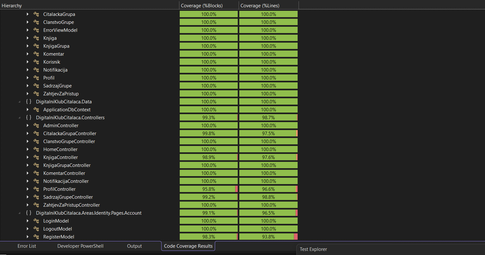

# Izvještaj o unit testiranju – Amina Peštalić

U okviru drugog zadatka na projektu **DigitalniKlubCitalaca** izvršila sam unit testiranje funkcionalnosti vezanih za članstvo korisnika u grupama, registraciju, prijavu i odjavu korisnika.

Testirane su sljedeće klase:
- `ClanstvoGrupeController`
- `RegisterModel`
- `LoginModel`
- `LogoutModel`

Ukupno su implementirane **43 testne metode**, odnosno **60 izvršavanja** kada se uključe parametrizovani testovi.

## Korištene tehnike testiranja

Tokom izrade testova korištene su različite tehnike, uključujući Simple-Test, Code-Path, Collection-Constraint, Parameter-Range, Process-State, Exception, Mock-Object i Service-Simulation.

Za testiranje različitih ulaznih podataka korištena su tri formata:

1. **CSV** – provjera validacije registracijske forme, uključujući obavezna polja, ispravnost e-mail adrese, minimalnu dužinu lozinke i podudaranje lozinke s potvrdom.
2. **XML** – provjera različitih ishoda prijave: uspješna prijava, zaključan korisnički nalog, dvofaktorska autentifikacija i neuspješna prijava.
3. **JSON** – provjera promjena statusa članstva u grupi.

Za izolaciju testova korišteni su **Moq**, EF Core InMemory baza i pomoćni objekti koji simuliraju ponašanje Identity servisa, autentifikacije, slanja e-mailova i pristupa podacima.

## Rezultati izvršavanja testova

Testovi su pokrenuti u Visual Studiju (Test Explorer → Run All) zajedno s testovima ostalih članica:

- Ukupno izvršenih testova: **395**
- Uspješno izvršenih: **395**
- Neuspješnih: **0**
- Preskočenih: **0**

Od toga su moji testovi 43 testne metode, odnosno 60 izvršavanja.

## Uočeni nedostaci

1. **ClanstvoGrupeController** – padajuća lista korisnika koristila je svojstvo `"KorisnikId"`, koje klasa `Korisnik` nema, pa su sve opcije bile prazne. **Ispravljeno** na `"Id", "Email"`; regresioni test `Create_Get_ListaKorisnikaImaIdKaoVrijednostIEmailKaoTekst` sada prolazi.
2. **ClanstvoGrupeController.Create** – omogućeno je višestruko dodavanje istog korisnika u istu grupu, bez provjere duplikata.
3. **RegisterModel.CreateUser** – `catch` blok nije dostižan za trenutnu implementaciju klase `Korisnik`, zbog čega ga nije moguće pokriti testom.
4. **LoginModel** – nedosljednost jezika korisničkih poruka: pojedine poruke su na bosanskom, a druge na engleskom.

## Pokrivenost koda

| Klasa | Pokrivenost blokova | Pokrivenost linija |
|---|---:|---:|
| ClanstvoGrupeController | 100 % | 100 % |
| LoginModel | 100 % | 100 % |
| LogoutModel | 100 % | 100 % |
| RegisterModel | 98,3 % | 93,8 % |

Jedine nepokrivene linije u `RegisterModel` su u nedostižnom `catch` bloku (nedostatak 3).

Rezultati iz Visual Studija (Test → Analyze Code Coverage for All Tests), nakon pokretanja svih 395 testova tima (395 uspješnih, 0 neuspješnih). Ukupna pokrivenost projekta je **99,3 % blokova i 98,7 % linija**.

*Slika 1. Ukupna pokrivenost, modeli i servisi.*

*Slika 2. Pokrivenost kontrolera i Identity stranica.*

## Zaključak

Implementirani testovi obuhvataju upravljanje članstvima u grupama, registraciju, prijavu i odjavu, uz pozitivne, negativne i granične scenarije. Sve četiri testirane klase su iznad traženih 90 % pokrivenosti, a testiranjem je pronađena i ispravljena greška u padajućoj listi korisnika.
