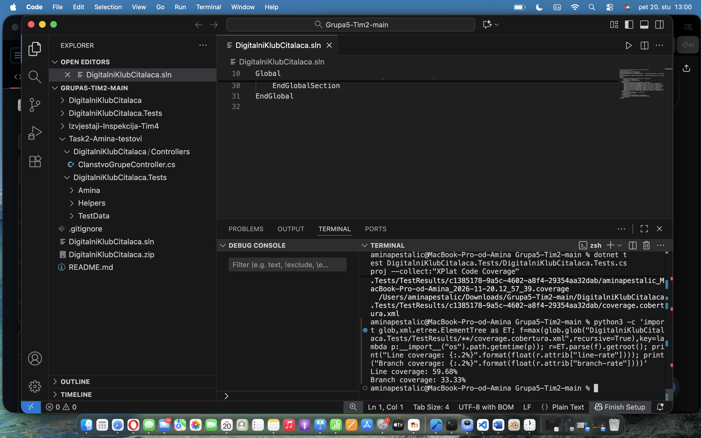

# Izvještaj o unit testiranju – Amina Peštalić

U okviru drugog zadatka na projektu **DigitalniKlubCitalaca** izvršila sam unit testiranje funkcionalnosti vezanih za članstvo korisnika u grupama, registraciju, prijavu i odjavu korisnika.

Testirane su sljedeće klase:
- `ClanstvoGrupeController`
- `RegisterModel`
- `LoginModel`
- `LogoutModel`

Ukupno su implementirane **43 testne metode**, odnosno **60 izvršavanja** kada se uključe parametrizovani testovi.

## Korištene tehnike testiranja

Tokom izrade testova korištene su različite tehnike, uključujući Simple-Test, Code-Path, Collection-Constraint, Parameter-Range, Process-State, Exception, Mock-Object i Service-Simulation.

Za testiranje različitih ulaznih podataka korištena su tri formata:

1. **CSV** – provjera validacije registracijske forme, uključujući obavezna polja, ispravnost e-mail adrese, minimalnu dužinu lozinke i podudaranje lozinke s potvrdom.
2. **XML** – provjera različitih ishoda prijave: uspješna prijava, zaključan korisnički nalog, dvofaktorska autentifikacija i neuspješna prijava.
3. **JSON** – provjera promjena statusa članstva u grupi.

Za izolaciju testova korišteni su **Moq**, EF Core InMemory baza i pomoćni objekti koji simuliraju ponašanje Identity servisa, autentifikacije, slanja e-mailova i pristupa podacima.

## Rezultati izvršavanja testova

Nakon uključivanja mojih testova u postojeći testni projekat, testovi su pokrenuti naredbom `dotnet test` uz prikupljanje podataka o pokrivenosti koda.

**Ukupni rezultati zajedničkog testnog projekta:**
- Ukupno izvršenih testova: **135**
- Uspješno izvršenih: **134**
- Neuspješnih: **1**
- Preskočenih: **0**

Jedini neuspješni test je `Create_Get_ListaKorisnikaImaIdKaoVrijednostIEmailKaoTekst` iz klase `ClanstvoGrupeControllerTests`. Prilikom čitanja elemenata `MultiSelectList` dolazi do izuzetka `NullReferenceException`.

## Pokrivenost koda

Na osnovu generisanog izvještaja `coverage.cobertura.xml` dobijeni su sljedeći rezultati:

- **Line Coverage: 59,68%**
- **Branch Coverage: 33,33%**

Navedeni procenti predstavljaju ukupnu pokrivenost koda ostvarenu izvršavanjem svih testova u zajedničkom testnom projektu, uključujući testove drugih članova tima.

## Uočeni nedostaci

Tokom testiranja identifikovani su sljedeći problemi:

1. **ClanstvoGrupeController** – neispravno povezivanje podataka u padajućoj listi korisnika zbog korištenja pogrešnog naziva svojstva. U izvještaju o implementaciji evidentirana je ispravka na `Id` i `Email`, ali regresioni test trenutno nije uspješno prošao.
2. **ClanstvoGrupeController.Create** – omogućeno je višestruko dodavanje istog korisnika u istu grupu, bez provjere duplikata.
3. **RegisterModel.CreateUser** – `catch` blok nije dostižan za trenutnu implementaciju klase `Korisnik`, zbog čega ga nije moguće pokriti predviđenim testom.
4. **LoginModel** – nedosljednost jezika korisničkih poruka, pri čemu se pojedine poruke prikazuju na bosanskom, a druge na engleskom.

## Pokrivenost koda

Nakon implementacije i pokretanja unit testova izvršena je analiza pokrivenosti koda.
Dobijeni rezultati su Line Coverage 59,68% i Branch Coverage 33,33%.

Na slici ispod prikazani su rezultati analize pokrivenosti koda.

## Zaključak

Implementirani testovi obuhvataju osnovne funkcionalnosti članstva u grupama i upravljanja korisničkim nalozima, kao i različite pozitivne, negativne i granične scenarije.

Pokretanjem zajedničkog testnog projekta uspješno su izvršena 134 od ukupno 135 testova. Preostali neuspješni test zahtijeva dodatnu provjeru i otklanjanje uzroka izuzetka.

Rezultati pokrivenosti ukazuju na potrebu za dodatnim testovima, posebno za grananja i alternativne tokove izvršavanja.

