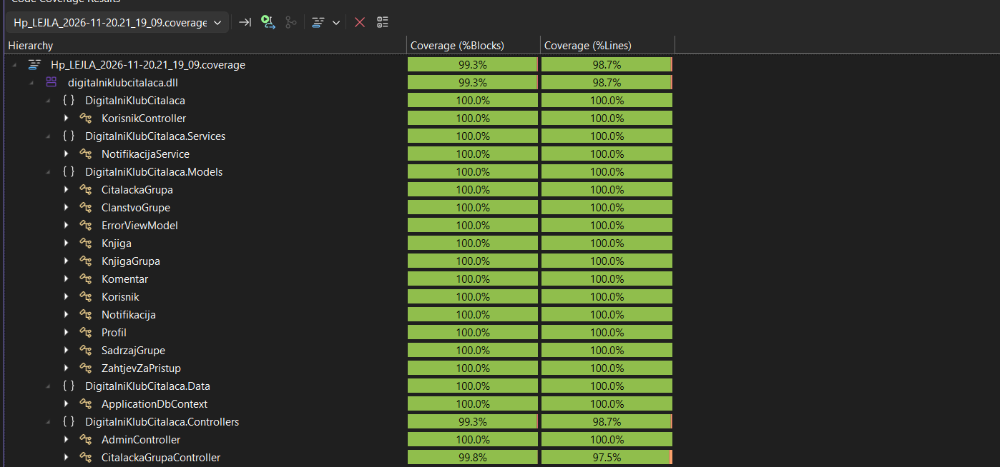
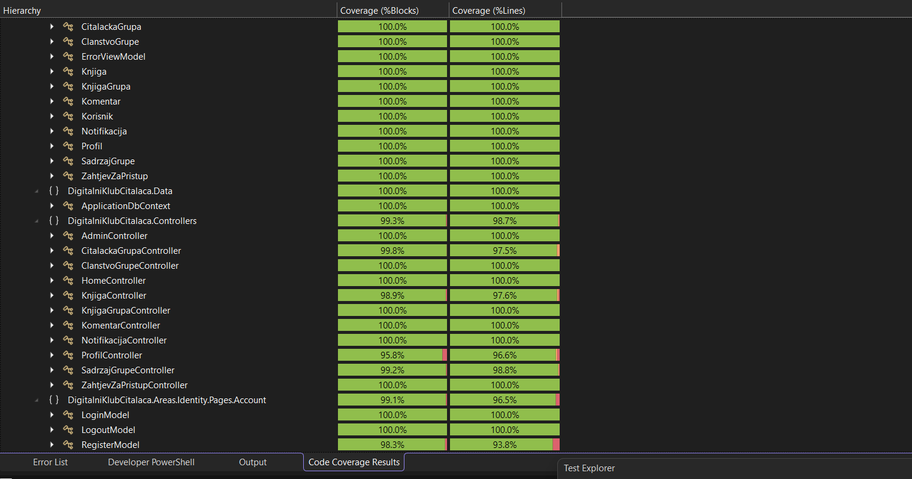

# Task 2 – Unit testiranje: Berina Šabeta

Testirane klase: `SadrzajGrupeController`, `KomentarController`
Ukupno testnih metoda: 36 + 18 = 54 (sa data-driven slučajevima i DataRow-ovima: 84 izvršavanja)

## Spisak testova

### SadrzajGrupeControllerTests
| # | Test | Stereotip |
|---|------|-----------|
| 1 | Index_TipIStarostIzJson_StoryVidljivSamo24Sata (7 slučajeva, JSON) | Simple-Test-Data / Parameter-Range (granica 24 h) |
| 2 | Index_PostojeceObjave_UcitaniAutorIGrupa | Collection-Constraint |
| 3 | Details_IdNullNepostojeciIliIstekliStory_VracaNotFound (3 DataRow) | Code-Path |
| 4 | Details_PostojecaObjava_KomentariSamoTeObjaveOdNajnovijeg | Collection-Order |
| 5 | Details_RazliciteUloge_JeModeratorSamoZaModeratora (4 DataRow) | Parameter-Range |
| 6 | DodajKomentar_NeprijavljenKorisnik_PreusmjeravaNaLogin | Code-Path |
| 7 | DodajKomentar_PrazanTekst_NeSpremaKomentar (3 DataRow) | Parameter-Range |
| 8 | DodajKomentar_TudjaObjava_SpremaKomentarIObavjestavaAutora | Process-State |
| 9 | DodajKomentar_AutorKomentariseSvojuObjavu_BezNotifikacije | Process-Rule |
| 10 | DodajKomentar_ObjavaBezAutoraIliNepostojeca_KomentarSpremljenBezNotifikacije (2 DataRow) | Code-Path |
| 11 | DodajKomentar_ModeracijaOznaciNeprikladan_KomentarImaStatusNeprikladan | Mock-Object |
| 12 | DodajKomentar_ModeracijaPropustiTekst_KomentarAktivanIModeracijaPozvanaJednom | Mock-Object |
| 13 | DodajKomentar_PrazanTekst_ModeracijaSeNePoziva | Mock-Object |
| 14 | DodajKomentar_ModeracijaNedostupna_IzuzetakIKomentarNijeSpremljen | Service-Simulation / Exception |
| 15 | Create_Get_NepoznatKorisnik_PreusmjeravaNaAccessDenied (2 DataRow) | Code-Path |
| 16 | Create_Get_Administrator_ZabranjenoUzPorukuOGresci | Process-Rule |
| 17 | Create_Get_ObicanKorisnik_VracaNovuObjavuZaGrupu | Simple-Test |
| 18 | Create_Post_NepoznatKorisnik_PreusmjeravaNaAccessDenied | Code-Path |
| 19 | Create_Post_Administrator_NeSpremaObjavu | Process-Rule |
| 20 | Create_Post_ValidacijaIzCsv_SpremaSamoIspravneObjave (7 slučajeva, CSV) | Simple-Test-Data / Process-Rule |
| 21 | Create_Post_IspravanClanak_PostavljaAutoraIObavjestavaOstaleClanove | Collection-Constraint |
| 22 | Create_Post_Story_PorukaONovomStoryju | Code-Path |
| 23 | Create_Post_GrupaNePostoji_PorukaSaZamjenskimNazivom | Code-Path |
| 24 | Create_Post_PdfSaFajlom_LinkVodiNaUploadovaniPdf | Simple-Test |
| 25 | Edit_IdSeNePoklapa_VracaNotFound | Code-Path |
| 26 | Edit_StoryBezSlike_VracaViewSaGreskom | Process-Rule |
| 27 | Edit_IspravnaIzmjena_SpremaIPreusmjeravaNaGrupu | Simple-Test |
| 28 | Edit_NoviPdf_ZamjenjujeLink | Process-State |
| 29 | Edit_ObjavaObrisanaUMedjuvremenu_VracaNotFound | Exception |
| 30 | Edit_KonkurentnaIzmjenaPostojeceObjave_BacaIzuzetak | Exception / Bit-Error-Simulation (stub) |
| 31 | Delete_KorisnikNijeModerator_PreusmjeravaNaAccessDenied (3 DataRow) | Parameter-Range |
| 32 | Delete_ModeratorIdNullIliNepostojeci_VracaNotFound (2 DataRow) | Code-Path |
| 33 | Delete_ModeratorPostojecaObjava_VracaViewZaPotvrdu | Simple-Test |
| 34 | DeleteConfirmed_KorisnikNijeModerator_NistaNeBrise | Process-Rule |
| 35 | DeleteConfirmed_ModeratorNepostojecaObjava_VracaNotFound | Code-Path |
| 36 | DeleteConfirmed_ModeratorPostojecaObjava_BriseIVracaNaGrupu | Simple-Test |

### KomentarControllerTests
| # | Test | Stereotip |
|---|------|-----------|
| 1 | Index_PostojeDvaKomentara_VracaObaSaAutoromIObjavom | Collection-Constraint |
| 2 | Details_IdNullIliNepostojeci_VracaNotFound (2 DataRow) | Code-Path |
| 3 | Details_PostojeciKomentar_VracaKomentar | Simple-Test |
| 4 | Create_Get_PadajuceListeAutoraIObjava | Simple-Test |
| 5 | Create_AutorIObjavaIzXml_NotifikacijaSamoZaTudjuObjavu (3 slučaja, XML) | Simple-Test-Data / Process-Rule |
| 6 | Create_KomentarNaTudjuObjavu_NotifikacijaIdeAutoruObjave | Process-State |
| 7 | Create_NevalidanModel_VracaViewBezSpremanja | Code-Path |
| 8 | Edit_Get_IdNullIliNepostojeci_VracaNotFound (2 DataRow) | Code-Path |
| 9 | Edit_Get_PostojeciKomentar_VracaViewSaListama | Simple-Test |
| 10 | Edit_Post_IdSeNePoklapa_VracaNotFound | Code-Path |
| 11 | Edit_Post_PromjenaStatusa_StatusSpremljen (2 DataRow) | Process-State |
| 12 | Edit_Post_NevalidanModel_VracaViewSaModelom | Code-Path |
| 13 | Edit_Post_KomentarObrisanUMedjuvremenu_VracaNotFound | Exception |
| 14 | Edit_Post_KonkurentnaIzmjena_BacaDbUpdateConcurrencyException | Exception / Bit-Error-Simulation (stub) |
| 15 | Delete_IdNullIliNepostojeci_VracaNotFound (2 DataRow) | Code-Path |
| 16 | Delete_PostojeciKomentar_VracaViewZaPotvrdu | Simple-Test |
| 17 | DeleteConfirmed_PostojeciKomentar_BriseSamoTajKomentar | Collection-Constraint |
| 18 | DeleteConfirmed_NepostojeciKomentar_NistaNeBrise | Code-Path |

## Data driven testiranje
- **JSON** (`TestData/Berina/vidljivost_objava.json`): vidljivost objava na listi (`SadrzajGrupeController.Index`).
  Story se prikazuje samo 24 sata od objave, a članak i PDF uvijek. Testirane su vrijednosti oko granice
  (1, 23, 24, 25 i 168 sati).
- **CSV** (`TestData/Berina/validacija_objave.csv`): validacija nove objave (`SadrzajGrupeController.Create`)
  po tipu sadržaja, linku i veličini PDF fajla. Svaki red sadrži očekivani rezultat validacije i očekivani broj
  spremljenih objava. Pravila su: story mora imati sliku, PDF mora imati neprazan fajl, a članak nema dodatnih uslova.
- **XML** (`TestData/Berina/komentari_notifikacije.xml`): da li autor objave dobija notifikaciju kada se kreira
  komentar (`KomentarController.Create`). Notifikacija se šalje za tuđu objavu, ali ne za vlastitu niti za nepostojeću objavu.

## Zamjenski objekti
- **IModeracijaService (mock, Moq)**: modul za automatsku moderaciju komentara još nije implementiran. Dodan je samo
  interfejs `DigitalniKlubCitalaca/Services/IModeracijaService.cs`, a `SadrzajGrupeController` ga prima kao opcioni parametar.
  Ako servis označi tekst kao neprikladan, komentar se sprema sa statusom `neprikladan`. Testovi provjeravaju sljedeće:
  - Neprikladan tekst dobija status `neprikladan`.
  - Prikladan tekst ostaje `aktivan`, a servis se poziva tačno jednom.
  - Za prazan tekst se servis uopće ne poziva.
  - Ako servis ne odgovara (simuliran izuzetak), komentar se ne sprema.
- **IFormFile**: PDF fajl u memoriji (`FormFile` + `MemoryStream`) umjesto stvarnog uploada iz browsera.
- **IUrlHelper, TempData, prijavljeni korisnik**: zamjene iz zajedničkog `TestHelper`-a.
- **KonkurentnostStubKontekst (ručni stub)**: simulira istovremenu izmjenu zapisa.
- **Baza**: EF Core InMemory, a svaki test dobija novu, izolovanu bazu.

## Uočen nedostatak u kodu
U `SadrzajGrupeController.Create` (POST) provjera `if (korisnikId == null) return RedirectToPage(...)` stoji
**poslije** provjere `trenutniKorisnik == null`. Kada korisnik nije prijavljen, `trenutniKorisnik` je uvijek `null`,
pa se akcija ranije vraća na AccessDenied. Zbog toga je ta linija nedostižna (mrtav kod) i nijedan test je ne može pokriti.
Prijedlog je da se ta provjera premjesti prije upita u bazu, kao u `DodajKomentar`.

## Pokrivenost koda

| Klasa | Pokrivenost blokova | Pokrivenost linija |
|---|---:|---:|
| SadrzajGrupeController | 99,2 % | 98,8 % |
| KomentarController | 100 % | 100 % |

Jedina nepokrivena linija u `SadrzajGrupeController` je nedostižna provjera `korisnikId == null` u `Create` (POST), opisana u dijelu „Uočen nedostatak u kodu“.

Rezultati iz Visual Studija (Test → Analyze Code Coverage for All Tests), nakon pokretanja svih 395 testova tima (395 uspješnih, 0 neuspješnih). Ukupna pokrivenost projekta je **99,3 % blokova i 98,7 % linija**.

*Slika 1. Ukupna pokrivenost, modeli i servisi.*

*Slika 2. Pokrivenost kontrolera i Identity stranica.*
