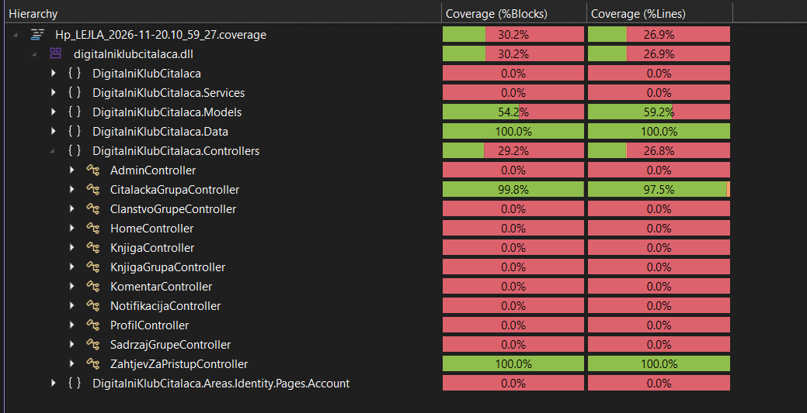

# Task 2 – Unit testiranje: Lejla Bajrić

Testirane klase: `CitalackaGrupaController`, `ZahtjevZaPristupController`
Ukupno testnih metoda: 31 + 27 = 58 (sa data-driven slučajevima i DataRow-ovima: 75 izvršavanja)

## Spisak testova

### CitalackaGrupaControllerTests
| # | Test | Stereotip |
|---|------|-----------|
| 1 | Index_NeprijavljenKorisnik_PreusmjeravaNaLogin | Code-Path |
| 2 | Index_KorisnikClanJedneGrupe_VracaSamoTuGrupu | Simple-Test |
| 3 | DostupneGrupe_NeprijavljenKorisnik_PreusmjeravaNaLogin | Code-Path |
| 4 | DostupneGrupe_FilteriIzCsv_VracaOcekivaniBrojGrupa (8 slučajeva, CSV) | Simple-Test-Data / Parameter-Range |
| 5 | DostupneGrupe_ClanstvoIZahtjevNaCekanju_IskljuceneGrupeKojeKorisnikVecIma | Collection-Constraint |
| 6 | DostupneGrupe_BezFiltera_SortiranoPoDatumuKreiranjaOpadajuce | Collection-Order |
| 7 | DostupneGrupe_ViewBagRegijeIZanrovi_JedinstveniISortirani | Collection-Order / Collection-Constraint |
| 8 | PridruziSe_NeprijavljenKorisnik_PreusmjeravaNaLogin | Code-Path |
| 9 | PridruziSe_NepostojecaGrupa_VracaNotFound | Code-Path (greška) |
| 10 | PridruziSe_KorisnikVecClan_NeDodajeNovoClanstvo | Process-Rule |
| 11 | PridruziSe_ZahtjevVecNaCekanju_NeDodajeNoviZahtjev | Process-Rule |
| 12 | PridruziSe_TipGrupeIzXml_KreiraOcekivaneZapise (3 slučaja, XML) | Simple-Test-Data / Code-Path |
| 13 | PridruziSe_JavnaGrupa_ClanstvoImaStatusClanIPorukuOUspjehu | Process-State |
| 14 | PridruziSe_PrivatnaGrupa_AdminDobijaObavijestOZahtjevu | Process-State |
| 15 | Details_IdNull_VracaNotFound | Code-Path |
| 16 | Details_NepostojecaGrupa_VracaNotFound | Code-Path |
| 17 | Details_PostojecaGrupa_VracaGrupuIObjaveOdNajnovije | Collection-Order |
| 18 | Create_Get_VracaPrazanView | Simple-Test |
| 19 | Create_ValidnaGrupa_SpremaSaDanasnjimDatumomIPreusmjerava | Simple-Test |
| 20 | Create_NevalidanModel_VracaViewIstimModelomINeSprema | Code-Path |
| 21 | Edit_Get_IdNullIliNepostojeci_VracaNotFound (2 DataRow) | Parameter-Range |
| 22 | Edit_Get_PostojecaGrupa_VracaViewSaGrupom | Simple-Test |
| 23 | Edit_Post_IdSeNePoklapa_VracaNotFound | Code-Path |
| 24 | Edit_Post_ValidnaIzmjena_AzuriraNazivIPreusmjerava | Simple-Test |
| 25 | Edit_Post_NevalidanModel_VracaViewSaModelom | Code-Path |
| 26 | Edit_Post_GrupaUMedjuvremenuObrisana_VracaNotFound | Exception (DbUpdateConcurrencyException uhvaćen) |
| 27 | Edit_Post_KonkurentnaIzmjenaPostojeceGrupe_BacaDbUpdateConcurrencyException | Exception / Bit-Error-Simulation (stub) |
| 28 | Delete_Get_IdNullIliNepostojeci_VracaNotFound (2 DataRow) | Parameter-Range |
| 29 | Delete_Get_PostojecaGrupa_VracaViewZaPotvrdu | Simple-Test |
| 30 | DeleteConfirmed_PostojecaGrupa_BriseGrupu / DeleteConfirmed_NepostojecaGrupa_NistaNeBriseIPreusmjerava | Simple-Test / Code-Path |

### ZahtjevZaPristupControllerTests
| # | Test | Stereotip |
|---|------|-----------|
| 1 | Index_PostojeDvaZahtjeva_VracaObaSaUcitanomGrupomIKorisnikom | Simple-Test / Collection-Constraint |
| 2 | Details_IdNullIliNepostojeci_VracaNotFound (2 DataRow) | Parameter-Range |
| 3 | Details_PostojeciZahtjev_VracaZahtjev | Simple-Test |
| 4 | Create_Get_PunViewDataSaGrupamaIKorisnicima | Simple-Test |
| 5 | Create_ValidanZahtjev_SpremaIPreusmjerava | Simple-Test |
| 6 | Create_NevalidanModel_VracaViewINePunioBazu | Code-Path |
| 7 | Edit_Get_IdNullIliNepostojeci_VracaNotFound (2 DataRow) | Parameter-Range |
| 8 | Edit_Get_PostojeciZahtjev_VracaViewSaPadajucimListama | Simple-Test |
| 9 | Edit_Post_IdSeNePoklapa_VracaNotFound | Code-Path |
| 10 | Edit_Post_ValidnaIzmjena_MijenjaStatus | Process-State |
| 11 | Edit_Post_NevalidanModel_VracaViewSaModelom | Code-Path |
| 12 | Edit_Post_ZahtjevObrisanUMedjuvremenu_VracaNotFound | Exception |
| 13 | Edit_Post_KonkurentnaIzmjenaPostojecegZahtjeva_BacaIzuzetak | Exception / Bit-Error-Simulation (stub) |
| 14 | Odobri_NepostojeciZahtjev_VracaNotFound | Code-Path |
| 15 | Odobri_KorisnikNijeClan_MijenjaStatusIDodajeClanstvo | Process-State |
| 16 | Odobri_KorisnikVecClanGrupe_NeDupliraClanstvo | Process-Rule |
| 17 | Odobri_NazivGrupeIzJson_NotifikacijaSadrziIspravnuPoruku (4 slučaja, JSON) | Data-Transformation |
| 18 | Odbij_NepostojeciZahtjev_VracaNotFound | Code-Path |
| 19 | Odbij_PostojeciZahtjev_StatusOdbijenBezNovogClanstva | Process-State |
| 20 | Odobri_EmailServisPostoji_SaljeTacnoJedanMailPodnosiocu | Mock-Object |
| 21 | Odbij_EmailServisPostoji_SaljeMailOOdbijanju | Mock-Object |
| 22 | Odobri_NepostojeciZahtjev_EmailSeNeSalje | Mock-Object |
| 23 | Odobri_EmailServisNedostupan_IzuzetakSePropagiraAliJeStatusVecSpremljen | Service-Simulation / Exception |
| 24 | Delete_Get_IdNullIliNepostojeci_VracaNotFound (2 DataRow) | Parameter-Range |
| 25 | Delete_Get_PostojeciZahtjev_VracaViewZaPotvrdu | Simple-Test |
| 26 | DeleteConfirmed_PostojeciZahtjev_BriseZahtjev | Simple-Test |
| 27 | DeleteConfirmed_NepostojeciZahtjev_PreusmjeravaBezBrisanja | Code-Path |

## Data driven testiranje
- **CSV** (`TestData/Lejla/dostupne_grupe_filteri.csv`): filtriranje dostupnih grupa po regiji i žanru
  (`CitalackaGrupaController.DostupneGrupe`). Svaki red sadrži regiju, žanr i očekivani broj grupa.
  Pokriveni su slučajevi bez filtera, sa jednim i sa oba filtera, te kombinacije bez rezultata.
  Grupe u kojima je korisnik već član ili ima zahtjev na čekanju ne smiju biti prikazane.
- **XML** (`TestData/Lejla/pridruzivanje_grupi.xml`): pridruživanje grupi po tipu grupe (`PridruziSe`).
  Za javnu grupu se odmah kreira članstvo i jedna notifikacija. Za privatnu grupu i grupu „pozivnica“ se kreira zahtjev
  na čekanju, a notifikaciju dobija korisnik i svaki drugi administrator (administrator koji šalje zahtjev ne dobija obavijest o vlastitom zahtjevu).
- **JSON** (`TestData/Lejla/odobravanje_zahtjeva.json`): tekst notifikacije pri odobravanju zahtjeva
  (`ZahtjevZaPristupController.Odobri`) za različite nazive grupa (navodnici, slova č/ć, prazan naziv).

## Zamjenski objekti
- **IEmailService (mock, Moq)**: modul za slanje e-mail obavijesti još nije implementiran. Dodan je samo interfejs
  `DigitalniKlubCitalaca/Services/IEmailService.cs`, a `ZahtjevZaPristupController` ga prima kao opcioni parametar.
  Testovi provjeravaju sljedeće:
  - Pri odobravanju i odbijanju šalje se tačno jedan mail podnosiocu zahtjeva, sa ispravnim naslovom i porukom.
  - Za nepostojeći zahtjev se mail ne šalje.
  - Ako servis baci izuzetak (simuliran pad SMTP servera), izuzetak se propagira, a promjena statusa je već spremljena.
- **UserManager&lt;Korisnik&gt; (mock)**: simulira prijavljenog ili neprijavljenog korisnika.
- **IUrlHelper (mock)**: `Url.Action` vraća fiksni link.
- **KonkurentnostStubKontekst (ručni stub)**: baza koja pri spremanju uvijek baca `DbUpdateConcurrencyException`.
  Simulira istovremenu izmjenu istog zapisa.
- **Baza**: EF Core InMemory umjesto SQL Servera, a svaki test dobija novu, izolovanu bazu.

## Pokrivenost koda
CitalackaGrupaController: 99,8 % blokova / 97,5 % linija · ZahtjevZaPristupController: 100 % / 100 %

