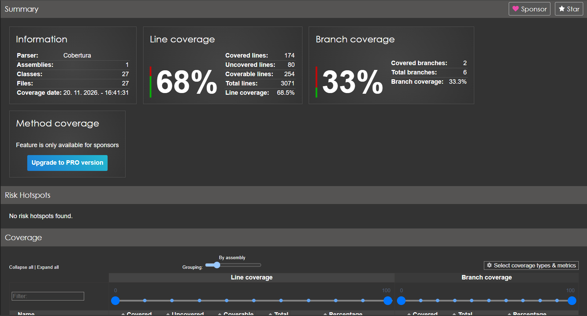
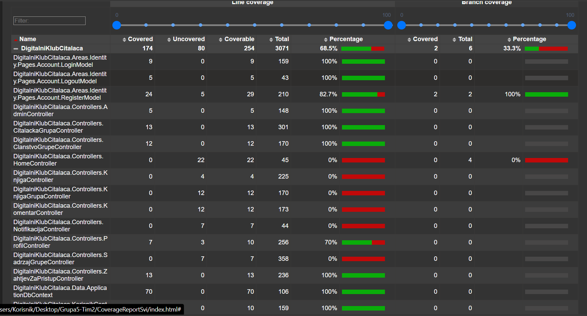
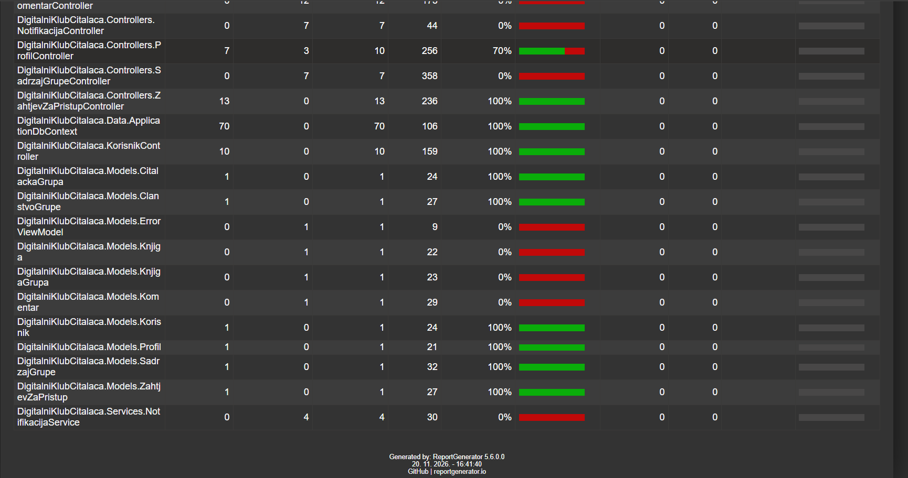

# Task 2 – Unit testiranje: Nedžmija Karić

Testirane klase: `AdminController`, `ProfilController`, `KorisnikController`
Ukupno testnih metoda: 19 + 21 + 18 = 58 (sa data-driven slučajevima i DataRow-ovima: 88 izvršavanja)

## Spisak testova

### AdminControllerTests
| # | Test | Stereotip |
|---|------|-----------|
| 1 | Index_KorisnikNijeAdministrator_PreusmjeravaNaAccessDenied (4 DataRow) | Parameter-Range / Process-Rule |
| 2 | PromijeniStatus_KorisnikNijeAdministrator_StatusSeNeMijenja (2 DataRow) | Process-Rule |
| 3 | PromijeniUlogu_KorisnikNijeAdministrator_UlogaSeNeMijenja (2 DataRow) | Process-Rule |
| 4 | Postavke_KorisnikNijeAdministrator_PreusmjeravaNaAccessDenied (2 DataRow) | Process-Rule |
| 5 | DnevnikAktivnosti_KorisnikNijeAdministrator_PreusmjeravaNaAccessDenied (2 DataRow) | Process-Rule |
| 6 | Index_PretragaIzJson_VracaOcekivaniBrojKorisnika (9 slučajeva, JSON) | Simple-Test-Data |
| 7 | Index_PretragaPoGradu_VracaTacnoTeKorisnikeIPamtiPojam | Collection-Constraint |
| 8 | PromijeniStatus_PocetniStatusIzXml_PrelaziUOcekivaniStatus (3 slučaja, XML) | Simple-Test-Data / Process-State |
| 9 | PromijeniStatus_DvaPuta_VracaNaPocetniStatus | Process-Sequence |
| 10 | PromijeniStatus_NepostojeciKorisnik_VracaNotFound | Code-Path |
| 11 | PromijeniUlogu_PocetnaUlogaIzXml_PrelaziUOcekivanuUlogu (3 slučaja, XML) | Simple-Test-Data / Process-State |
| 12 | PromijeniUlogu_NepostojeciKorisnik_VracaNotFound | Code-Path |
| 13 | PromijeniUlogu_AdministratorSamomSebi_GubiAdministratorskaPrava | Process-Sequence |
| 14 | Postavke_Administrator_VracaView | Simple-Test |
| 15 | DnevnikAktivnosti_Administrator_VracaView | Simple-Test |
| 16 | PromijeniStatus_UspjesnaPromjena_BiljeziSeUDnevnikJednom | Mock-Object |
| 17 | PromijeniUlogu_UspjesnaPromjena_BiljeziSeAdminKojiJePromijenio | Mock-Object |
| 18 | PromijeniStatus_BezPravaIliNepostojeciKorisnik_NistaSeNeBiljezi | Mock-Object |
| 19 | PromijeniUlogu_DnevnikNedostupan_IzuzetakAliJeUlogaVecPromijenjena | Service-Simulation / Exception |

### ProfilControllerTests
| # | Test | Stereotip |
|---|------|-----------|
| 1 | Index_KorisnikBezProfila_PreusmjeravaNaKreiranjeProfila | Code-Path |
| 2 | Index_KorisnikSaProfilom_VracaSvojProfilIBrojGrupa | Simple-Test |
| 3 | Details_IdNullIliNepostojeci_VracaNotFound (2 DataRow) | Code-Path |
| 4 | Details_PostojeciProfil_VracaProfilSaKorisnikom | Simple-Test |
| 5 | Create_Get_VracaPrazanView | Simple-Test |
| 6 | Create_Post_NeprijavljenKorisnik_PreusmjeravaNaLogin | Code-Path |
| 7 | Create_Post_IspravanProfil_VezujeSeZaPrijavljenogKorisnikaIObavjestava | Process-Rule |
| 8 | Create_Post_NevalidanModel_VracaViewBezSpremanja | Code-Path |
| 9 | Edit_Get_IdNullNepostojeciIliTudjiProfil_VracaNotFound (3 DataRow) | Parameter-Range / Process-Rule |
| 10 | Edit_Get_SvojProfil_VracaViewSaProfilom | Simple-Test |
| 11 | Edit_Post_IdSeNePoklapa_VracaNotFound | Code-Path |
| 12 | Edit_Post_TudjiProfil_VracaNotFoundINistaNeMijenja | Process-Rule |
| 13 | Edit_Post_PodaciIzCsv_ProfilIKorisnikSinhronizovani (4 slučaja, CSV) | Data-Transformation |
| 14 | Edit_Post_IspravnaIzmjena_NotifikacijaIPorukaOUspjehu | Process-State |
| 15 | Edit_Post_NevalidanModel_VracaProfilIzBazeBezIzmjena | Code-Path |
| 16 | Delete_IdNullIliNepostojeci_VracaNotFound (2 DataRow) | Code-Path |
| 17 | Delete_PostojeciProfil_VracaViewZaPotvrdu | Simple-Test |
| 18 | DeleteConfirmed_PostojeciProfil_BriseProfilAliNeKorisnika | Collection-Constraint |
| 19 | DeleteConfirmed_NepostojeciProfil_NistaNeBrise | Code-Path |
| 20 | PromijeniProfilnuSliku_NepoznatKorisnik_VracaNotFound (2 DataRow) | Code-Path |
| 21 | PromijeniProfilnuSliku_PrijavljenKorisnik_SlikaPromijenjenaSamoNjemu | Simple-Test |

### KorisnikControllerTests
| # | Test | Stereotip |
|---|------|-----------|
| 1 | Index_DvaKorisnika_VracaListuSaObaKorisnika | Simple-Test |
| 2 | Details_IdNullIliNepostojeci_VracaNotFound (2 DataRow) | Code-Path |
| 3 | Details_PostojeciKorisnik_VracaKorisnika | Simple-Test |
| 4 | Create_Get_VracaPrazanView | Simple-Test |
| 5 | Create_Post_IspravanKorisnik_SpremaIPreusmjerava | Simple-Test |
| 6 | Create_Post_NevalidanModel_VracaViewBezSpremanja | Code-Path |
| 7 | Edit_Get_IdNullIliNepostojeci_VracaNotFound (2 DataRow) | Code-Path |
| 8 | Edit_Get_GuidKorisnika_VracaViewSaKorisnikom | Simple-Test (regresioni) |
| 9 | Edit_Post_IdSeNePoklapa_VracaNotFound | Code-Path |
| 10 | Edit_Post_IspravnaIzmjena_MijenjaStatusNaloga | Process-State |
| 11 | Edit_Post_NevalidanModel_VracaViewSaModelom | Code-Path |
| 12 | Edit_Post_KorisnikObrisanUMedjuvremenu_VracaNotFound | Exception |
| 13 | Edit_Post_KonkurentnaIzmjena_BacaDbUpdateConcurrencyException | Exception / Bit-Error-Simulation (stub) |
| 14 | Delete_IdNullIliNepostojeci_VracaNotFound (2 DataRow) | Code-Path |
| 15 | Delete_PostojeciKorisnik_VracaViewZaPotvrdu | Simple-Test |
| 16 | DeleteConfirmed_GuidKorisnika_BriseKorisnika | Simple-Test (regresioni) |
| 17 | DeleteConfirmed_NepostojeciKorisnik_NistaNeBrise | Code-Path |
| 18 | Find_IntVrijednostNadGuidKljucem_BacaArgumentException | Exception (dokaz greške) |

## Data driven testiranje
- **JSON** (`TestData/Nedzmija/pretraga_korisnika.json`): pretraga korisnika u admin panelu (`AdminController.Index`).
  Pretražuje se po imenu, prezimenu, e-mailu, gradu i regiji, uključujući dio riječi, dijakritike, praznu pretragu
  i pretragu bez rezultata.
- **XML** (`TestData/Nedzmija/promjene_naloga.xml`): očekivano stanje nakon jedne promjene statusa naloga
  (aktivan → blokiran, blokiran → aktivan, neaktivan → aktivan) i jedne promjene uloge
  (korisnik → moderator, moderator → administrator, administrator → moderator).
- **CSV** (`TestData/Nedzmija/izmjena_profila.csv`): izmjena profila (`ProfilController.Edit`). Provjerava se da
  se podaci profila i korisnika uskladišteni u dvije tabele sinhronizuju: `Grad` = lokacija i `Biografija` = opis profila.
  Pokriveni su prazni opis i lokacija, dijakritike i posebni znakovi.

## Zamjenski objekti
- **IDnevnikAktivnostiService (mock, Moq)**: modul dnevnika administratorskih aktivnosti još nije implementiran (stranica
  „Dnevnik aktivnosti“ je prazna). Dodan je interfejs `DigitalniKlubCitalaca/Services/IDnevnikAktivnostiService.cs`, a `AdminController` ga
  prima kao opcioni parametar. Testovi provjeravaju sljedeće:
  - Svaka uspješna promjena statusa i uloge bilježi se tačno jednom, sa ispravnim adminom, akcijom i korisnikom.
  - Kada akcija nije dozvoljena ili korisnik ne postoji, ništa se ne bilježi.
  - Ako dnevnik ne odgovara (simuliran izuzetak), promjena uloge je ipak već spremljena.
- **KonkurentnostStubKontekst (ručni stub)**: simulira istovremenu izmjenu korisnika.
- **TempData, prijavljeni korisnik, IUrlHelper**: zamjene iz zajedničkog `TestHelper`-a.
- **Baza**: EF Core InMemory, a svaki test dobija novu, izolovanu bazu.

## Greške pronađene testiranjem
1. **`KorisnikController.Edit` (GET) i `DeleteConfirmed` primali su `int`**, a ključ korisnika (ASP.NET Identity)
   je `string` (GUID). Zbog toga uređivanje i brisanje korisnika nikada nisu radili: `Edit` je uvijek vraćao NotFound,
   a `DeleteConfirmed` je pri `Find` bacao `ArgumentException`. **Ispravljeno** (parametri su sada `string`), a dodani su
   regresioni testovi 8 i 16 i test 18 koji pokazuje uzrok.
2. **`AdminController.PromijeniUlogu`**: administrator može promijeniti ulogu sam sebi i time izgubiti pristup admin panelu
   (test 13). Ako je to jedini administrator, sistem ostaje bez administratora. Prijedlog je da se zabrani promjena vlastite uloge.
3. **`ProfilController.Details`, `Delete` i `DeleteConfirmed` ne provjeravaju vlasnika profila**, pa bilo koji prijavljeni
   korisnik može obrisati tuđi profil. `Edit` tu provjeru ima.
4. **`ProfilController.ProfilExists`** je privatna metoda koja se nigdje ne poziva (mrtav kod), pa je ne pokriva nijedan test.
5. **`ProfilController.Edit` (POST)** baca `NullReferenceException` ako forma ne pošalje podatke o korisniku (`profil.Korisnik` je `null`).

## Rezultati izvršavanja testova

Nakon integracije testova svih članica tima izvršena su ukupno 223 testna slučaja.

| Rezultat | Broj testova |
|---|---:|
| Ukupno | 223 |
| Uspješni | 215 |
| Neuspješni | 8 |
| Preskočeni | 0 |
| Postotak uspješnosti | 96,41% |

## Pokrivenost koda (Code Coverage)

Pokrivenost koda izmjerena je pomoću alata Coverlet, dok je vizuelni prikaz rezultata generisan pomoću alata ReportGenerator, nakon pokretanja testova svih članica tima.

### Ukupna pokrivenost projekta prema generisanom izvještaju

- **Line Coverage:** 68,5%
- **Branch Coverage:** 33,3%
- Broj pokrivenih linija: 174
- Broj nepokrivenih linija: 80
- Broj linija obuhvaćenih mjerenjem: 254
- Broj pokrivenih grana: 2 od 6

### Pokrivenost testiranih klasa

| Klasa | Pokrivene linije | Linije obuhvaćene mjerenjem | Line Coverage |
|---|---:|---:|---:|
| AdminController | 5 | 5 | 100% |
| ProfilController | 7 | 10 | 70% |
| KorisnikController | 10 | 10 | 100% |

### Grafički prikaz rezultata

*Slika 1. Ukupna pokrivenost koda.*

*Slika 2. Pokrivenost pojedinačnih klasa.*

*Slika 3. Nastavak prikaza pokrivenosti klasa.*