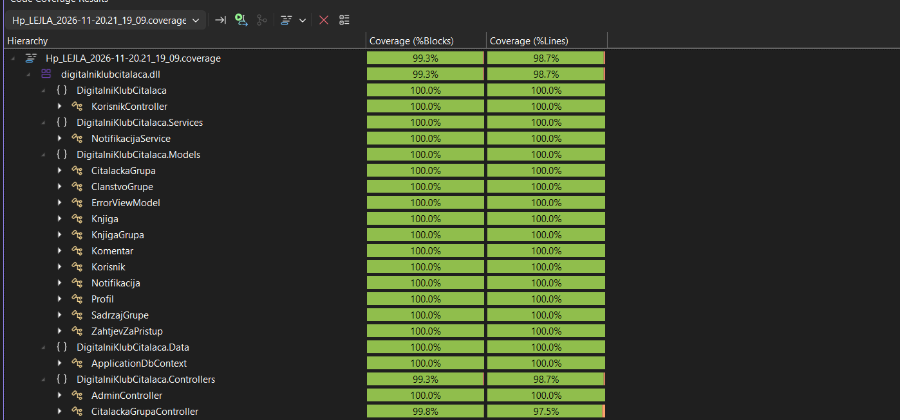
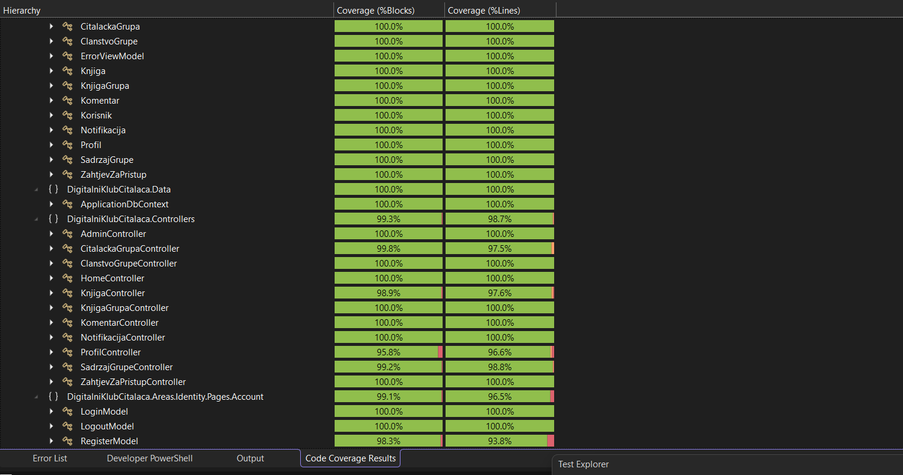

# Task 2 – Unit testiranje: Nejra Mašović

Testirane klase: `KnjigaController`, `KnjigaGrupaController`, `NotifikacijaController`, `NotifikacijaService`, `HomeController` (+ `ErrorViewModel`)
Ukupno testnih metoda: 31 + 18 + 5 + 4 + 8 = 66 (sa data-driven slučajevima i DataRow-ovima: 88 izvršavanja)

## Spisak testova

### KnjigaControllerTests
| # | Test | Stereotip |
|---|------|-----------|
| 1 | Index_FilterZanraIzCsv_VracaOcekivaniBrojKnjiga (6 slučajeva, CSV) | Simple-Test-Data |
| 2 | Index_KorisnikIzXml_AdminOpcijeSamoZaAdministratora (5 slučajeva, XML) | Simple-Test-Data / Process-Rule |
| 3 | Index_BezFiltera_KnjigeSortiraneAbecedno | Collection-Order |
| 4 | Index_FilterRoman_ZanroviZaPadajucuListuSviIBezDuplikata | Collection-Constraint |
| 5 | Details_IdNullIliNepostojeci_VracaNotFound (2 DataRow) | Code-Path |
| 6 | Details_PostojecaKnjigaZaAdmina_VracaKnjiguIAdminOpcije | Simple-Test |
| 7 | Citaj_NepostojecaKnjigaIliBezPdfa_VracaNotFound (2 DataRow) | Code-Path |
| 8 | Citaj_KnjigaSaPdfom_PreusmjeravaNaPdf | Simple-Test |
| 9 | Create_Get_NijeAdministrator_VracaForbid (3 DataRow) | Parameter-Range / Process-Rule |
| 10 | Create_Post_NijeAdministrator_VracaForbidINeSprema | Process-Rule |
| 11 | Edit_NijeAdministrator_ObjeAkcijeVracajuForbid | Process-Rule |
| 12 | Delete_NijeAdministrator_KnjigaOstaje | Process-Rule |
| 13 | Create_Get_Administrator_VracaView | Simple-Test |
| 14 | Create_Post_BezPdfa_GreskaNaFormi | Code-Path |
| 15 | Create_Post_PrazanPdfOd0Bajtova_GreskaNaFormi | Parameter-Range (granica) |
| 16 | Create_Post_BezSkladista_PdfSeSpremaLokalnoUBiblioteku | Simple-Test |
| 17 | Create_Post_SaSkladistem_PutanjaIzSkladistaIFajlProslijedjenJednom | Mock-Object |
| 18 | Create_Post_NevalidnaForma_SkladisteSeNePoziva | Mock-Object |
| 19 | Create_Post_SkladisteNedostupno_IzuzetakIKnjigaNijeDodana | Service-Simulation / Exception |
| 20 | Edit_Post_NoviPdfSaSkladistem_ZamjenjujeStaruPutanju | Mock-Object |
| 21 | Edit_Get_IdNullIliNepostojeci_VracaNotFound (2 DataRow) | Code-Path |
| 22 | Edit_Get_PostojecaKnjiga_VracaView | Simple-Test |
| 23 | Edit_Post_IdSeNePoklapaIliKnjigaNePostoji_VracaNotFound | Code-Path |
| 24 | Edit_Post_BezNovogPdfa_ZadrzavaStaruPutanjuIakoFormaSaljeDrugu | Process-Rule |
| 25 | Edit_Post_PrazanNoviPdf_ZadrzavaStaruPutanju | Parameter-Range (granica) |
| 26 | Edit_Post_NoviPdfBezSkladista_SpremaSeLokalno | Process-State |
| 27 | Edit_Post_NevalidanModel_VracaViewSaStaromPutanjom | Code-Path |
| 28 | Delete_Get_IdNullIliNepostojeci_VracaNotFound (2 DataRow) | Code-Path |
| 29 | Delete_Get_PostojecaKnjiga_VracaViewZaPotvrdu | Simple-Test |
| 30 | DeleteConfirmed_PostojecaKnjiga_BriseSeIzKataloga | Simple-Test |
| 31 | DeleteConfirmed_NepostojecaKnjiga_PreusmjeravaBezGreske | Code-Path |

### KnjigaGrupaControllerTests
| # | Test | Stereotip |
|---|------|-----------|
| 1 | Index_DvijeDodjele_VracaObjeSaKnjigomIGrupom | Collection-Constraint |
| 2 | Details_IdNullIliNepostojeci_VracaNotFound (2 DataRow) | Code-Path |
| 3 | Details_PostojecaDodjela_VracaNazivKnjigeIGrupe | Simple-Test |
| 4 | Create_Get_ListeSadrzeSveKnjigeIGrupe | Collection-Constraint |
| 5 | Create_Post_IspravnaDodjela_KnjigaDodanaGrupi | Simple-Test |
| 6 | Create_Post_NevalidanModel_VracaViewSaOznacenimVrijednostima | Code-Path |
| 7 | Create_Post_IstaKnjigaUIstojGrupi_DuplikatSeSprema | Process-Rule (dokumentuje nedostatak) |
| 8 | Edit_Get_IdNullIliNepostojeci_VracaNotFound (2 DataRow) | Code-Path |
| 9 | Edit_Get_PostojecaDodjela_ListeOznacavajuTrenutnuKnjiguIGrupu | Simple-Test |
| 10 | Edit_Post_IdSeNePoklapa_VracaNotFound | Code-Path |
| 11 | Edit_Post_PremjestanjeKnjigeUDruguGrupu_Spremljeno | Process-State |
| 12 | Edit_Post_NevalidanModel_VracaViewSaModelom | Code-Path |
| 13 | Edit_Post_DodjelaObrisanaUMedjuvremenu_VracaNotFound | Exception |
| 14 | Edit_Post_KonkurentnaIzmjena_BacaDbUpdateConcurrencyException | Exception / Bit-Error-Simulation (stub) |
| 15 | Delete_IdNullIliNepostojeci_VracaNotFound (2 DataRow) | Code-Path |
| 16 | Delete_PostojecaDodjela_VracaViewZaPotvrdu | Simple-Test |
| 17 | DeleteConfirmed_PostojecaDodjela_KnjigaUklonjenaIzGrupeAliOstajeUKatalogu | Collection-Constraint |
| 18 | DeleteConfirmed_NepostojecaDodjela_NistaNeBrise | Code-Path |

### NotifikacijaControllerTests
| # | Test | Stereotip |
|---|------|-----------|
| 1 | Index_NeprijavljenKorisnik_PreusmjeravaNaPocetnu | Code-Path |
| 2 | Index_PrijavljenKorisnik_SamoNjegoveOdNajnovije | Collection-Order |
| 3 | Index_OtvaranjeListe_SveNjegoveOznaceneKaoProcitaneUBazi | Process-State |
| 4 | Index_OtvaranjeListe_TudjeNotifikacijeOstajuNeprocitane | Collection-Constraint |
| 5 | Index_KorisnikBezNotifikacija_PraznaLista | Simple-Test |

### NotifikacijaServiceTests
| # | Test | Stereotip |
|---|------|-----------|
| 1 | DodajNotifikacijuAsync_PodaciIzJson_SpremljenoTacnoKakoJePoslano (3 slučaja, JSON) | Simple-Test-Data |
| 2 | DodajNotifikacijuAsync_NovaNotifikacija_NeprocitanaSaTrenutnimDatumom | Simple-Test |
| 3 | DodajNotifikacijuAsync_TriPoziva_TriZasebneNotifikacije | Process-Sequence |
| 4 | DodajNotifikacijuAsync_KontekstZatvoren_BacaObjectDisposedException | Exception |

### HomeControllerTests
| # | Test | Stereotip |
|---|------|-----------|
| 1–5 | Index / About / Help / Privacy / AccessDenied_VracaView | Simple-Test |
| 6 | Error_BezAktivnosti_RequestIdJeTraceIdentifier | Code-Path |
| 7 | Error_UnutarAktivnosti_RequestIdJeIdAktivnosti | Code-Path |
| 8 | ErrorViewModel_RequestId_ShowRequestIdSamoAkoPostoji (3 DataRow) | Parameter-Range |

## Data driven testiranje
- **CSV** (`TestData/Nejra/knjige_po_zanru.csv`): filtriranje kataloga knjiga po žanru (`KnjigaController.Index`). Pokriveni su
  slučajevi bez filtera, filter sa samim razmacima, žanr sa više knjiga, sa jednom knjigom i bez ijedne knjige.
- **XML** (`TestData/Nejra/uloge_katalog.xml`): koji korisnici vide administratorske opcije u katalogu. Testirani su neprijavljen
  korisnik, čitalac, moderator, administrator i korisnik koji više ne postoji u bazi.
- **JSON** (`TestData/Nejra/notifikacije.json`): `NotifikacijaService.DodajNotifikacijuAsync` mora spremiti notifikaciju tačno
  onakvu kakva je poslana: poruku sa navodnicima, dijakritikama i emojijem, kao i link koji je `null` ili prazan.

## Zamjenski objekti
- **IPdfStorageService (mock, Moq)**: vanjsko skladište za PDF knjige (npr. cloud) još nije implementirano. Dodan je interfejs
  `DigitalniKlubCitalaca/Services/IPdfStorageService.cs`, a `KnjigaController` ga prima kao opcioni parametar. Dok servis ne
  postoji, PDF se sprema lokalno u `wwwroot/biblioteka`. Testovi provjeravaju sljedeće:
  - Knjiga dobija putanju koju vrati skladište, a fajl se skladištu prosljeđuje tačno jednom.
  - Kada forma nije ispravna, skladište se ne poziva.
  - Ako skladište ne radi, knjiga se ne dodaje u katalog.
  - Pri izmjeni knjige novi PDF zamjenjuje stari.
- **UserManager&lt;Korisnik&gt; (mock)**: simulira prijavljenog korisnika u `NotifikacijaController`.
- **IFormFile**: PDF u memoriji (`FormFile` + `MemoryStream`).
- **KonkurentnostStubKontekst (ručni stub)** i **EF Core InMemory baza**: koriste se za kontrolere sa bazom.

## Izmjena koda i nalazi
1. **Refaktorisanje `KnjigaController`**: isti kod za spremanje PDF-a postojao je dvaput, u `Create` i u `Edit`. Izdvojen je u
   privatnu metodu `SpremiPdf`, koja koristi `IPdfStorageService` ako je dostupan, a inače lokalni disk.
2. **`KnjigaController.DeleteConfirmed`** briše knjigu iz baze, ali **PDF fajl ostaje na disku**. Na pravoj bazi (SQL Server)
   brisanje knjige koja je dodijeljena nekoj grupi pada zbog stranog ključa (`DeleteBehavior.NoAction`), a korisnik dobija grešku
   umjesto poruke.
3. **`KnjigaController.Edit`**: novi PDF se sprema na disk **prije** provjere `ModelState`. Ako forma nije ispravna, fajl
   ostaje na disku bez knjige koja ga koristi.
4. **`KnjigaGrupaController.Create`** dozvoljava da se ista knjiga više puta doda u istu grupu (test 7).
   Padajuće liste prikazuju ID-eve umjesto naziva knjige i grupe.

## Pokrivenost koda

| Klasa | Pokrivenost blokova | Pokrivenost linija |
|---|---:|---:|
| KnjigaController | 98,9 % | 97,6 % |
| KnjigaGrupaController | 100 % | 100 % |
| NotifikacijaController | 100 % | 100 % |
| NotifikacijaService | 100 % | 100 % |
| HomeController | 100 % | 100 % |
| ErrorViewModel | 100 % | 100 % |

Rezultati iz Visual Studija (Test → Analyze Code Coverage for All Tests), nakon pokretanja svih 395 testova tima (395 uspješnih, 0 neuspješnih). Ukupna pokrivenost projekta je **99,3 % blokova i 98,7 % linija**.

*Slika 1. Ukupna pokrivenost, modeli i servisi.*

*Slika 2. Pokrivenost kontrolera i Identity stranica.*
